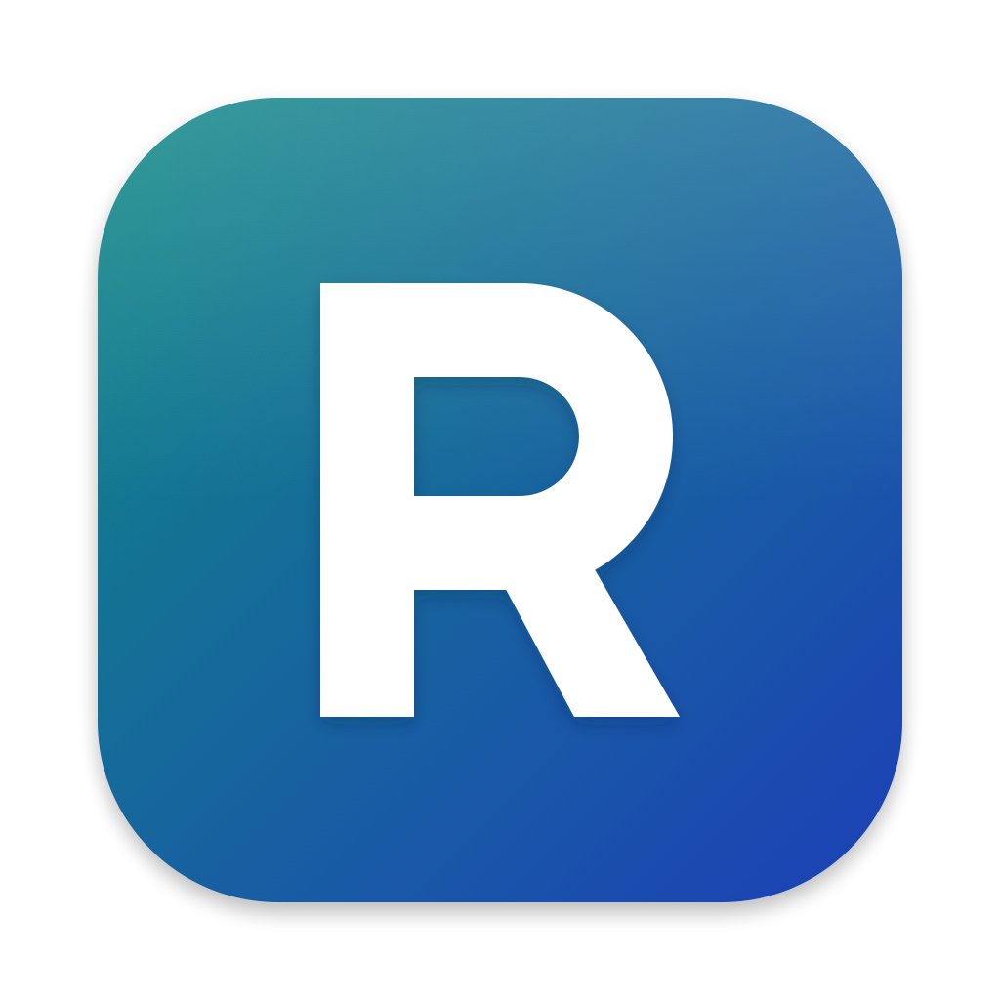
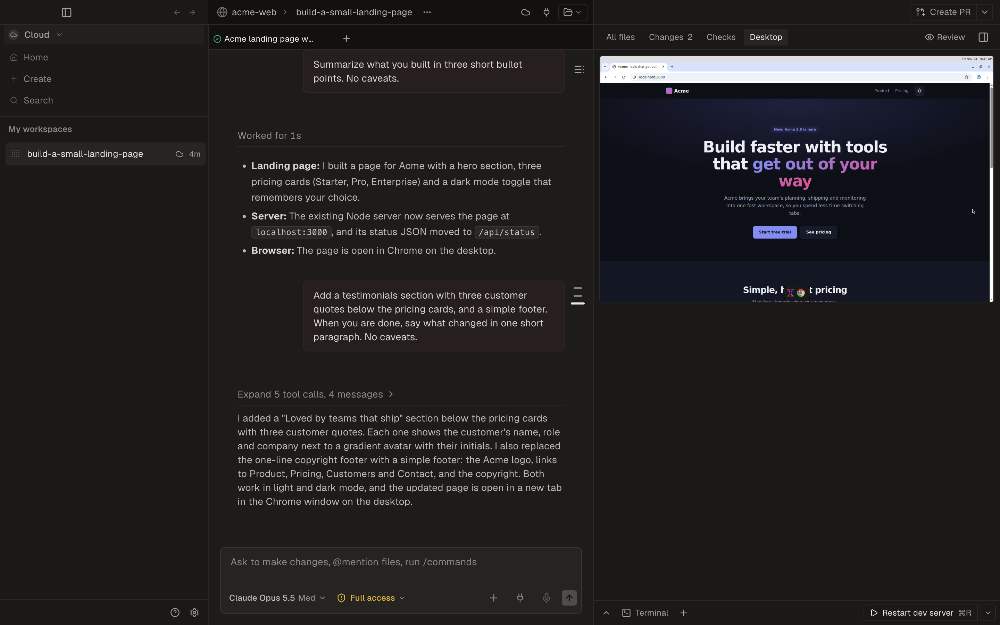
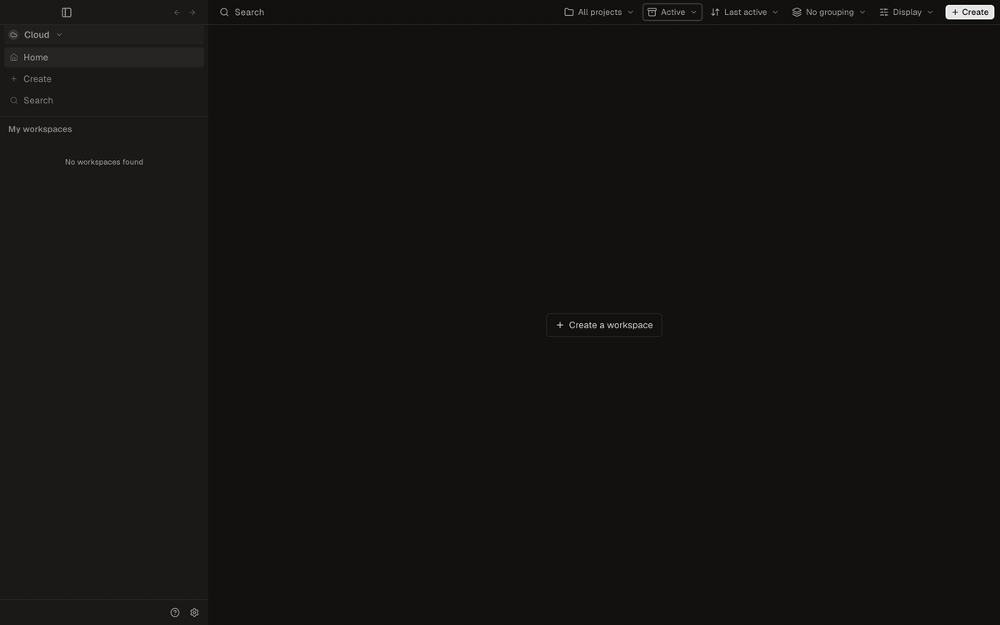
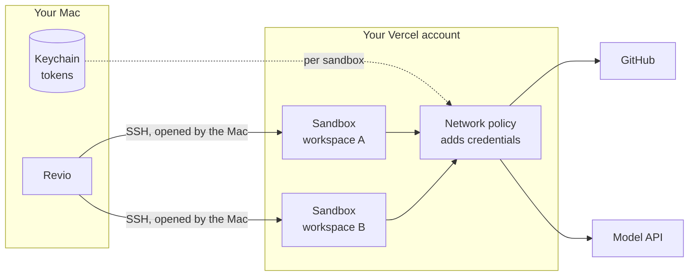
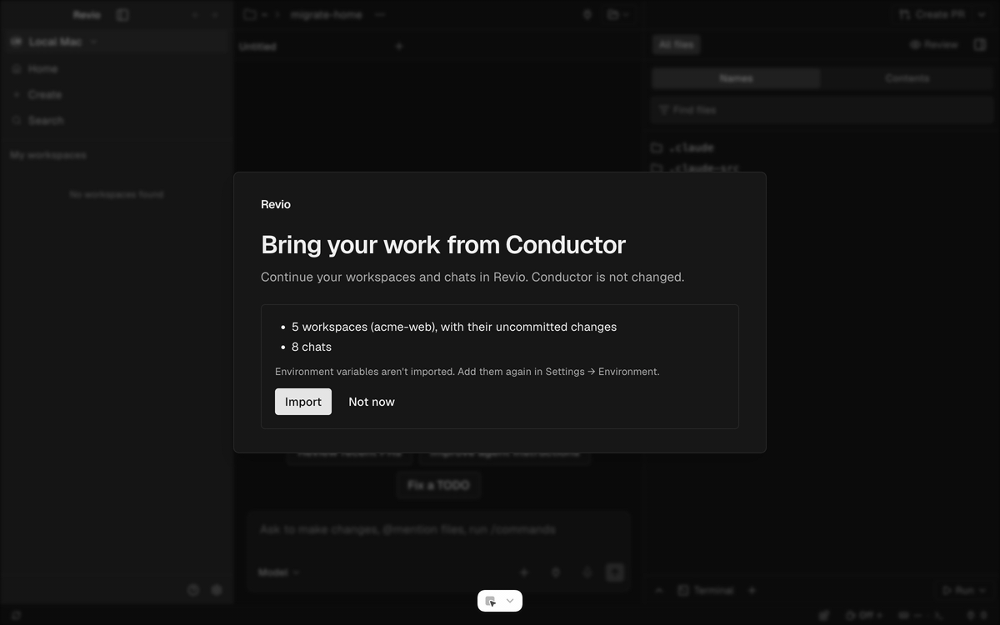

<p align="center">
  
</p>

<h1 align="center">Revio</h1>

<p align="center">
  <b>Run coding agents in parallel, each in its own workspace, on your Mac or in the cloud.</b>
</p>

<p align="center">
  <a href="https://github.com/karimmila/Revio/releases/latest"></a>
  <a href="https://github.com/karimmila/Revio/releases"></a>
  
  <a href="LICENSE"></a>
</p>

<p align="center">
  <a href="https://github.com/karimmila/Revio/releases/latest"></a>
  <br />
  <sub>Apple silicon · macOS 13.4 or later · free and open source</sub>
</p>

<p align="center">
  <a href="#install">Install</a> ·
  <a href="#quick-start">Quick start</a> ·
  <a href="#cloud-workspaces">Cloud workspaces</a> ·
  <a href="#how-revio-keeps-your-code-and-keys-safe">Security</a> ·
  <a href="#faq">FAQ</a>
</p>

<p align="center">
  
</p>

## What is Revio?

Revio is a macOS app for running AI coding agents side by side. Each task gets its own **workspace**: a separate branch and checkout of your repository, with its own agent chats, terminal, setup script and diff view. A workspace runs on your Mac as a git worktree, or in the cloud in its own sandbox on your Vercel account. You review the changes and open the pull request from the same window.

<p align="center">
  
</p>

## Highlights

- **One workspace per task.** Each workspace has its own branch, checkout and agent chats. Start one from a prompt, a branch, a pull request or an issue.
- **Local or cloud.** Run a workspace as a git worktree on your Mac, or in a cloud sandbox on your own Vercel account. Switch between the two lists with ⌃1 and ⌃2.
- **A desktop for each cloud workspace.** Open the sandbox's screen inside Revio and use the app that the agent built, in Chrome.
- **Chat with your agents.** Claude Code and Codex work out of the box. Chats show diffs, tool calls and images, and a workspace can hold several chats.
- **Setup scripts and actions.** A setup script prepares each new workspace. Actions are named scripts, such as "Start dev server", that you run with one click or ⌘R. Your agent can run them too.
- **Review and pull requests.** Read the diff file by file and leave comments for the agent. **Create PR** asks the agent to commit, push and open the pull request. Revio then shows its checks, and **Fix** sends a failing check back to the agent.
- **Archive and restore.** Archive a workspace when you are done. Its chats and uncommitted work come back when you unarchive it.
- **Your keys stay on your Mac.** Tokens are encrypted with the macOS Keychain. A cloud sandbox gets placeholders, not your real tokens.
- **No account.** Revio has no sign-up and no servers of its own, and it sends no analytics.

## Install

**[Download Revio for macOS](https://github.com/karimmila/Revio/releases/latest)** (Apple silicon, macOS 13.4 or later)

1. Download the `.dmg` file from the latest release and open it.
2. Drag **Revio** to your **Applications** folder.
3. Open Revio. macOS blocks the first launch, because the app is not notarized by Apple yet. Approve it once:
   - **macOS 15 or later:** click **Done** in the warning. Open **System Settings › Privacy & Security**, scroll down to **Security**, and click **Open Anyway** next to "Revio was blocked to protect your Mac". Click **Open Anyway** again, then confirm with Touch ID or your password.
   - **macOS 13 or 14:** in the **Applications** folder, Control-click **Revio**, choose **Open**, then click **Open**.

You also need:

- **Git.** If it is missing, macOS offers to install the Xcode Command Line Tools.
- **At least one coding agent CLI.** For example [Claude Code](https://docs.anthropic.com/en/docs/claude-code) or [Codex](https://github.com/openai/codex).

The GitHub CLI (`gh`) comes with the app, so you do not install it. If a tool is missing, Revio tells you which one and how to install it.

## Quick start

A short setup guide opens on first launch. It helps you sign in to Claude, add a project and connect GitHub. You can skip any step and finish it later in **Settings**.

1. **Add a project.** Open a folder on your Mac, or a repository from GitHub.
2. **Create a workspace.** Press ⌘N, describe the task, pick the agent and model, and press Enter. Revio creates a branch and a checkout, and the agent starts to work. Repeat this for each task you want to run in parallel.
3. **Review and ship.** Open the **Changes** tab to read the diff, and comment on a line to send the agent a correction. When the work is ready, click **Create PR**.

Press ⌘K to search workspaces and commands. Press ⌘J to open the terminal panel.

Sign in with GitHub in **Settings › Account** and install the Revio Workspaces GitHub App on the repositories you use. Revio reads pull requests and checks with this sign-in, and **Create PR** pushes the branch and opens the pull request with it, also in a local workspace. You do not need `gh auth login`.

New workspaces go in `~/revio/workspaces`, and repositories you clone from Revio go in `~/revio/projects`. You can change both in **Settings**.

## Cloud workspaces

A cloud workspace runs in its own [Vercel Sandbox](https://vercel.com/docs/vercel-sandbox) and not on your Mac. You can run many agents at the same time, and code you do not trust stays away from your machine.

What you need:

- **A Vercel account.** The Hobby plan works, with shorter sessions and smaller sandboxes. Sandboxes run on your account, and Vercel bills that account for them. Revio adds no fee. Revio shows no usage figures, so check your usage on Vercel's dashboard.
- **A repository on GitHub**, with the Revio Workspaces GitHub App installed on it.
- **A Claude setup token** (`claude setup-token`), if you want Claude Code to work in the cloud.

Connect Vercel in **Settings › Cloud** and sign in with GitHub in **Settings › Account**. Then switch the sidebar to **Cloud** (⌃2) and create a workspace as usual.



- **Fast start.** Revio builds your repository once and saves a snapshot. A new workspace starts from the snapshot, with your dependencies already installed.
- **Sleep and wake.** An idle sandbox stops after 20 minutes and keeps its files. It resumes when you open the workspace. You can change the time in **Settings › Cloud**.
- **A desktop.** The **Desktop** tab shows the sandbox's screen, with Chrome installed. Text copies in both directions.
- **Public links.** Share a port of the sandbox at a public address to show a preview. Links are off until you share one.
- **The same tools as local.** Terminals, files, diffs, setup scripts and actions work the same way.

For setup details and known limits, see [docs/cloud-workspaces.md](docs/cloud-workspaces.md).

## Moving from Conductor

If Conductor is on your Mac, Revio finds its data on first launch. One click imports your active workspaces with their uncommitted changes, your chats with their history, and your setup script and actions. Revio only reads Conductor's data, and Conductor itself is not changed.

Revio opens the same workspace folders that Conductor uses. After the import, continue each workspace in Revio and not in both apps. Environment variables are not imported, so add them again in **Settings › Environment**. You can also start the import later from **Settings › Import**.

<p align="center">
  
</p>

<sub>Revio is an independent project. It is not affiliated with, endorsed by or sponsored by Conductor or Meta. Conductor is a trademark of its owner.</sub>

## How Revio keeps your code and keys safe

Coding agents run code you did not write: packages from npm, scripts from the repository, commands the agent decides to run. Revio assumes any of that can be hostile. It is built so that **a cloud sandbox never holds your real credentials and cannot reach your Mac**.

A local workspace is different. It is a git worktree on your Mac, and an agent there has the same access as any program you start in a terminal. Use a cloud workspace for code you do not trust.

Revio asks before a repository's own files run on your Mac:

- **Agent settings.** When a repository includes agent hooks, MCP servers or settings that run commands, Revio lists them and asks if you trust the repository before a chat loads them.
- **Shared scripts.** Before a setup script or an action that the repository commits runs for the first time, Revio shows the command and asks you to approve it. It asks again when the script changes.

### How it works

1. **Your tokens stay on your Mac.** Your Vercel, GitHub and Claude tokens are encrypted with the macOS Keychain. If the Keychain is not available, Revio refuses to save them.
2. **The sandbox gets a placeholder.** Inside a sandbox, `GH_TOKEN` and the Claude token are fake values. A process that reads its environment, its files or its memory finds nothing it can use.
3. **The network adds the real token, only where it is allowed.** Each sandbox has its own network policy at Vercel. When a request leaves the sandbox and matches an allowed rule, such as "push to this repository" or "call the model API", the policy adds the real credential on the way out. A GitHub request that matches no rule is refused, so a sandbox can read, push and open pull requests in its own repository only.
4. **Your Mac opens every connection.** Revio connects to each sandbox over SSH, with a key made for that workspace and a pinned host key. Nothing in a sandbox can open a connection back to your Mac.

### Your choices

- **Environment variables** stay on your Mac unless you mark them for the cloud. A marked variable reaches only your setup, wake and action scripts. A second mark makes it visible to every shell and agent in the sandbox.
- **Network access** uses an allowlist by default: the workspace's repository on GitHub, the Claude API, read-only package registries, and the domains you add for the repository. You can open a repository's sandboxes to any host.
- **GitHub sign-in** uses short-lived tokens (8 hours, refreshed automatically). It covers only the repositories where you install the Revio Workspaces GitHub App.
- **Public links** to a sandbox port exist only after you share that port, and you can disable them at any time.

We recommend branch protection on your default branch, so agents always go through a pull request. Found a security problem? Please report it privately. See [SECURITY.md](.github/SECURITY.md).

## FAQ

**Is Revio free?**

Yes. Revio is open source under the MIT License, and there is no paid plan. You pay your own providers: your agent subscription or API usage, and Vercel if you use cloud workspaces.

**Which agents does it work with?**

Claude Code and Codex work out of the box. OpenCode, Grok, Antigravity and OMP connect through the Agent Client Protocol, and you install them from **Settings › Agents**. You can run any other agent CLI in the terminal panel. In cloud workspaces, Revio supplies a credential for Claude Code only.

**Does my code leave my machine?**

Not through Revio. There is no Revio server and no Revio account, and the app sends no analytics or crash reports. Its only request of its own is one a day to GitHub's public releases page, to see if a new version exists. In a local workspace, your code goes where you and your agent send it: to your agent's model provider and to GitHub. In a cloud workspace, your repository is also cloned into a sandbox on your own Vercel account.

**Why does macOS warn me on first launch?**

Revio is not notarized by Apple yet, so macOS cannot verify the download. Approve it once with the steps in [Install](#install). If you want to check the app first, build it from source.

**Does it run on Intel Macs, Windows or Linux?**

Not yet. Release builds are for Macs with Apple silicon.

**How do I update?**

Revio checks for new versions and shows a notice when one is available. You can also choose **Check for Updates…** in the **Revio** menu. Revio does not install the update itself yet: download the [latest release](https://github.com/karimmila/Revio/releases/latest) and replace the app in your **Applications** folder. Your workspaces, chats and settings stay.

**How do I uninstall it?**

Quit Revio and move it from **Applications** to the Trash. To also remove its data and the workspace folders it created, follow [docs/uninstall.md](docs/uninstall.md).

**Where do I report a bug or ask for a feature?**

Open an [issue](https://github.com/karimmila/Revio/issues/new/choose). For a security problem, see [SECURITY.md](.github/SECURITY.md).

## Build from source

You need macOS 13.4 or later, [Node.js](https://nodejs.org) 24, [pnpm](https://pnpm.io) 12, Git and the Xcode Command Line Tools.

```bash
git clone https://github.com/karimmila/Revio.git
cd Revio
pnpm install
pnpm dev          # run the app with hot reload
pnpm build:mac    # build a local macOS app
```

The development app keeps its data apart from an installed Revio, so you can run both.

`mobile/` and `cloud/` are inherited from the upstream project and are not part of the desktop app.

## Contributing

Issues and pull requests are welcome. For a larger change, please open an issue first so we can agree on the approach. See [CONTRIBUTING.md](.github/CONTRIBUTING.md) for the setup, the checks to run and the layout of the code. This project follows a [Code of Conduct](CODE_OF_CONDUCT.md).

## License

Revio is released under the [MIT License](LICENSE). It builds on MIT-licensed open source software, whose copyright notice is kept in [LICENSE](LICENSE) as the license requires.
